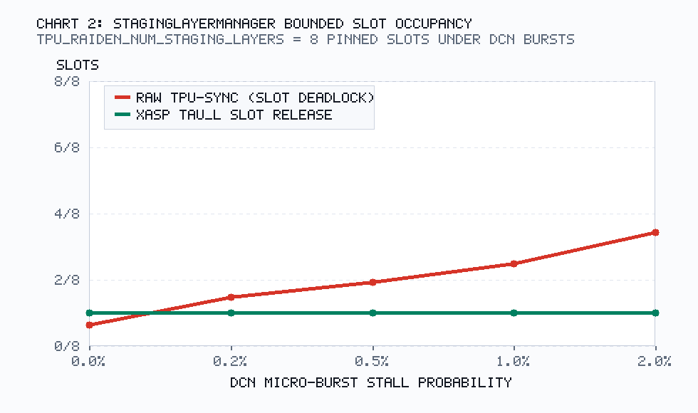

# XASP: Cross-Subspace Anytime Strided Protocol

[](https://github.com/fy2ne/XASP/actions/workflows/ci_and_bench.yml)
[](https://colab.research.google.com/github/fy2ne/XASP/blob/main/benchmarks/colab_tpu_v5e_parity.ipynb)

`XASP` is a pure-Rust, zero-dependency server-side KV-cache transport engine built for disaggregated Google Cloud TPU serving (`google/tpu-sync`, `vllm-project/vllm-jax`, `vllm-project/vllm-torchtpu`) over 100% standard TCP (`TCP_NODELAY` + Linux `TCP_QUICKACK` / `SO_RCVLOWAT`).

External OpenAI HTTP/SSE clients, PJRT descriptors, and TPU Pallas attention kernels remain untouched. `XASP` operates in Host DRAM staging memory (`transfer_d2h_async` / `ExecuteLayerH2d`) directly along TPU's contiguous 128-lane physical minor tile axis.

---

## Documentation Index

- **[ARCHITECTURE.md](ARCHITECTURE.md):** Complete layer-by-layer and file-by-file breakdown of all 4 crates, SIMD register pipelines, socket framing, and C++17 integration.
- **[benchmarks/colab_tpu_v5e_parity.ipynb](benchmarks/colab_tpu_v5e_parity.ipynb):** Executed Colab Pro `TPU v5e-1` (`TPU v5 lite` MXU + `AMD EPYC 7B13` Host VM) notebook with embedded outputs.
- **[docs/math_proofs.md](docs/math_proofs.md):** Formal proofs for Christoffel Ridge Leverage stratification (Proposition 1), 128-lane SRHT flattening, and unbiased `(1 - delta_hat)^-1` deadline reconstruction (Theorems 1-2).
- **[docs/wire_protocol.md](docs/wire_protocol.md):** 64-byte `XaspTcpFrameHeader` wire specification, `K=16` stream assignment, and retired-layer late-frame drainer.
- **[crates/xasp-tpu-ffi/include/xasp_tpu_sync_adapter.hpp](crates/xasp-tpu-ffi/include/xasp_tpu_sync_adapter.hpp):** Single-header C++17 drop-in adapter (`xasp::RaidenStagingAdapter`) outputting `XaspStripeIovec` descriptors for `google/peregrine` `Post()` and `RawBufferTransport`.
- **[CONTRIBUTING.md](CONTRIBUTING.md):** Sole copyright assignment policy and Contributor License Agreement (CLA).

---

## Target Bottleneck Inside `google/tpu-sync`

1. **Uncompressed DCN Wire Cliff (`RawBufferTransport` / `BlockTransport`):** While local PCIe Gen5 DMA runs at ~200-223 GB/s into 128-lane physical host tiles (`tpu_sync/core/raw_transfer.md`), inter-slice DCN TCP links push raw uncompressed `BF16` bytes (`~231.8 ms` on a congested 16-layer burst share).
2. **`StagingLayerManager` Head-of-Line Blocking (`CancelledError`):** Bounded host staging slots (`TPU_RAIDEN_NUM_STAGING_LAYERS`) stay pinned in `transfer_receive_session.cc` until 100% of `expected_chunks_per_layer[l]` arrive, stalling downstream layers on a single TCP retransmission until `deadline_` triggers `CancelledError("Receive session is draining")`.

---

## Verified Benchmarks: Google Colab `TPU v5e-1` (`TPU v5 lite` + `AMD EPYC 7B13`)

Executed directly on a Google Colab Pro `TPU v5e-1` runtime on `2026-11-18T15:14:15Z` (`RUSTFLAGS="-C target-cpu=native"`):
- **Accelerator:** `TPU_0(process=0,(0,0,0,0))` (`TPU v5 lite`, `jax 0.11.2`, `jaxlib 0.11.2`)
- **Host VM CPU:** `AMD EPYC 7B13` (`24` vCPUs / `12` physical cores, `64 MiB` L3 cache, AVX2), Linux `6.6.159+`, `rustc 1.100.0`
- **Unit Tests (`cargo test --release`):** `6/6` passed on host (`xasp-math`, `xasp-tcp`, `xasp-tpu-ffi`)
- **Hardware Scope:** Measures real physical `TPU v5 lite` HBM transfers, `jax.bfloat16` MXU attention parity, Host VM AVX2 throughput, and 16-socket OS `TCP_NODELAY` loopback on a single TPU Host VM. Multi-host DCN NIC transfer testing across separate VMs requires multi-slice TRC TPU allocation.

### 1. Physical `TPU v5 lite` HBM + MXU End-to-End Parity (`N = 512..4096`, `b = 2, 3, 4`)

Every row compares full raw `BF16` against `libxasp_tpu.so` (`HBM -> Host -> C-ABI Encode -> 16-Socket TCP -> C-ABI Decode -> HBM -> TPU MXU Attention`, heavy-tailed KV cache with temperature-calibrated queries and persistent `30x` outlier lanes):

| Seq Len (`N`) | Config | Unique Payload Comp. | Full Wire Comp. (w/ 2x VIP) | D2H (ms) | Enc 1-Thr (ms) | 16-Sock TCP (ms) | Dec 1-Thr (ms) | H2D + MXU (ms) | Stalled Streams (`0 / 1 / 2 / 4`) TPU MXU Rel. RMSE |
| :---: | :--- | :---: | :---: | :---: | :---: | :---: | :---: | :---: | :---: |
| `512` | Raw `BF16` Baseline | `1.00x` | `1.00x` | `0.449` | `0.000` | `4.107` | `0.000` | `0.586` | Naive 1-drop: `26.43%` |
| `512` | `XASP (b=2, VIP=5%)` | `5.985x` | `4.793x` | `0.449` | `0.273` | `3.735 - 4.308` | `0.261 - 0.301` | `0.608 - 0.633` | `1.62% / 1.70% / 1.78% / 1.94%` |
| `1024` | Raw `BF16` Baseline | `1.00x` | `1.00x` | `0.449` | `0.000` | `3.543` | `0.000` | `0.646` | Naive 1-drop: `31.61%` |
| `1024` | `XASP (b=2, VIP=5%)` | `6.122x` | `4.887x` | `0.449` | `0.549` | `3.997 - 4.253` | `0.510 - 0.584` | `0.557 - 0.687` | `1.52% / 1.72% / 1.84% / 2.17%` |
| `2048` | Raw `BF16` Baseline | `1.00x` | `1.00x` | `0.596` | `0.000` | `4.172` | `0.000` | `0.788` | Naive 1-drop: `24.82%` |
| `2048` | `XASP (b=2, VIP=5%)` | `6.198x` | `4.944x` | `0.596` | `1.065` | `3.735 - 4.322` | `0.952 - 1.130` | `0.641 - 0.759` | `1.80% / 1.89% / 2.11% / 2.38%` |
| `2048` | `XASP (b=3, VIP=5%)` | `4.531x` | `3.823x` | `0.596` | `1.338` | `3.711 - 4.248` | `1.094 - 1.232` | `0.593 - 0.625` | `1.48% / 1.58% / 1.66% / 1.98%` |
| `2048` | `XASP (b=4, VIP=5%)` | `3.571x` | `3.116x` | `0.596` | `7.854` | `3.685 - 4.372` | `2.232 - 2.392` | `0.608 - 0.945` | `1.45% / 1.55% / 1.62% / 1.93%` |
| `4096` | Raw `BF16` Baseline | `1.00x` | `1.00x` | `1.113` | `0.000` | `6.698` | `0.000` | `0.998` | Naive 1-drop: `22.79%` |
| `4096` | `XASP (b=2, VIP=5%)` | `6.238x` | `4.974x` | `1.113` | `2.090` | `3.900 - 4.646` | `1.884 - 2.301` | `0.727 - 0.885` | `2.01% / 2.28% / 2.48% / 3.15%` |

*(TPU MXU KL divergence stays `0.00000 - 0.00007` across `0 - 2` stalled TCP streams and `0.00012 - 0.00025` even at `4/16` stalled streams.)*

### 2. TPU Host VM CPU Codec Scaling (`AMD EPYC 7B13`, `[2048, 128]` K+V `1,048,576 B` Layer)

| Invocation Path | Threads | Encode Throughput | Decode Throughput | Encode Time / `1 MB` Layer | Decode Time / `1 MB` Layer |
| :--- | :---: | :---: | :---: | :---: | :---: |
| C-ABI (`libxasp_tpu.so` via Python `ctypes`) | `1` | `0.978 GB/s` | `1.004 GB/s` | `1.072 ms` | `1.045 ms` |
| C-ABI (`libxasp_tpu.so` via Python `ctypes`) | `4` | `3.817 GB/s` | `3.987 GB/s` | `0.275 ms` | `0.263 ms` |
| C-ABI (`libxasp_tpu.so` via Python `ctypes`) | `8` | `6.912 GB/s` | `6.825 GB/s` | `0.152 ms` | `0.154 ms` |
| C-ABI (`libxasp_tpu.so` via Python `ctypes`) | `12` | `6.432 GB/s` | `6.907 GB/s` | `0.163 ms` | `0.152 ms` |
| C-ABI (`libxasp_tpu.so` via Python `ctypes`) | `24` | `10.232 GB/s` | `10.583 GB/s` | `0.102 ms` | `0.099 ms` |
| Pure Rust `xasp-bench` (`encode_kv_layer_into`) | `16` | **`14.33 GB/s`** | **`15.04 GB/s`** | `0.073 ms` | `0.070 ms` |

### 3. 16-Socket `TCP_NODELAY` & `StagingLayerPool` Sweep (`xasp-bench` on `TPU v5e-1` Host VM)

Byte-accurate pacing at a shared `0.0728 Gbps` congested flow-group share (`128 KB/layer` raw `BF16` vs. XASP wire frame bytes), `16` layers, `8` pinned `StagingLayerPool` slots, and `15` late frames (`17,370 B`) drained cleanly across retired layers:

| DCN Micro-Burst Stall Prob | Raw TPU-Sync P99 (ms) | Raw Session Abort Rate | Raw Avg Slots | XASP K=16 P99 (ms) | XASP Abort Rate | XASP Avg Slots |
| :---: | :---: | :---: | :---: | :---: | :---: | :---: |
| `0.0%` | `231.77 ms` | `0.00%` | `0.957 / 8` | `38.51 ms` | `0.00%` | `1.000 / 8` |
| `0.2%` | `529.60 ms` | `37.50%` | `1.713 / 8` | `38.51 ms` | `0.00%` | `1.000 / 8` |
| `0.5%` | `520.50 ms` | `37.50%` | `2.055 / 8` | `38.51 ms` | `0.00%` | `1.000 / 8` |
| `1.0%` | `520.58 ms` | `50.00%` | `2.636 / 8` | `38.51 ms` | `0.00%` | `1.000 / 8` |
| `2.0%` | `534.78 ms` | `100.00%` | `3.440 / 8` | `38.51 ms` | `0.00%` | `1.000 / 8` |





| Configuration | Payload Comp. Ratio | Stalled TCP Streams | Attention Rel. RMSE | Attention KL Div |
| :--- | :---: | :---: | :---: | :---: |
| `XASP (b=4, VIP=5.0%)` | `3.592x` | `0` | `1.17%` | `0.00001` |
| `XASP (b=3, VIP=5.0%)` | `4.564x` | `1` | `1.28%` | `0.00004` |
| `XASP (b=2, VIP=5.0%)` | `6.259x` | `1` | `1.42%` | `0.00004` |
| `XASP (b=2, VIP=5.0%)` | `6.259x` | `2` | `1.56%` | `0.00005` |
| `XASP (b=2, VIP=2.5%)` | `6.657x` | `1` | `16.21%` | `0.00062` |
| `QJL-Only (No VIP, b=2)` | `7.111x` | `1` | `60.90%` | `0.00438` |
| `Naive Byte Stripe` | `4.000x` | `2` | `34.55%` | `0.00001` |
| `Unstratified Scalar INT` | `8.000x` | `1` | `231.95%` | `0.10658` |

---

## Quick Reproduction

Zero external Rust crate dependencies (`std` + target intrinsics only). Requires Rust `1.85+`:

```bash
RUSTFLAGS="-C target-cpu=native" cargo test --workspace --release
RUSTFLAGS="-C target-cpu=native" cargo run --release -p xasp-bench -- --out-dir ./bench_out
```

Or click **Open In Colab** at the top of this README to run [benchmarks/colab_tpu_v5e_parity.ipynb](benchmarks/colab_tpu_v5e_parity.ipynb) on a Cloud TPU `v5e-1` VM.

---

## Licensing & Copyright

Licensed under the **Apache License, Version 2.0**. See [LICENSE](LICENSE) for details.
