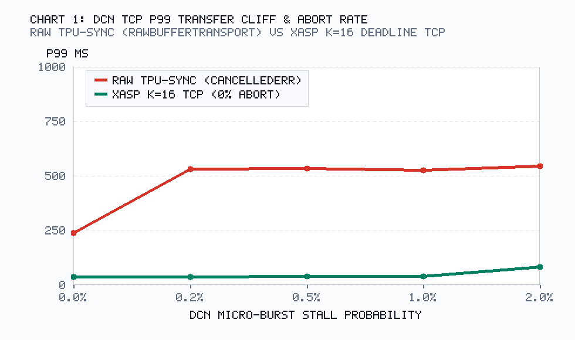
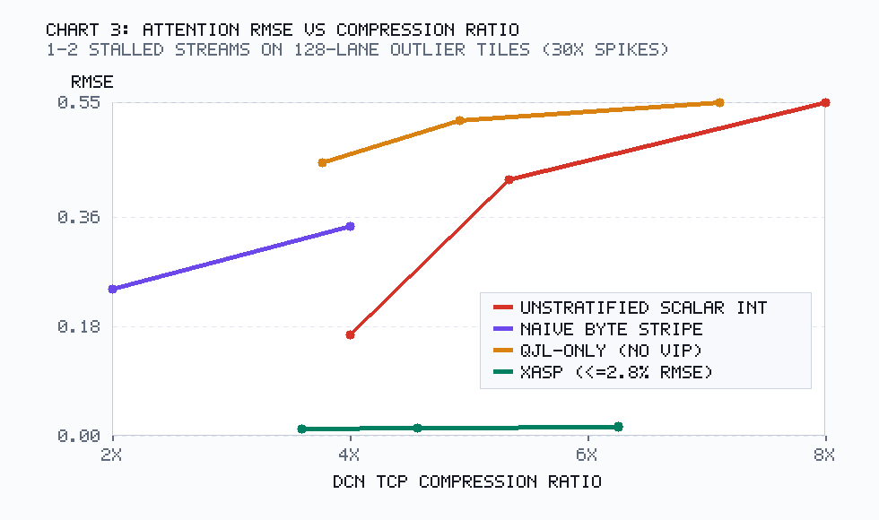

# XASP: XLA-Aligned Spectral Protocol

[](https://github.com/fy2ne/XASP/actions/workflows/ci_and_bench.yml)

`XASP` is a pure-Rust, zero-dependency server-side KV-cache transport engine built for disaggregated Google Cloud TPU serving (`google/tpu-sync`, `vllm-project/vllm-jax`, `vllm-project/vllm-torchtpu`) over 100% standard TCP (`TCP_NODELAY` + Linux `TCP_QUICKACK` / `SO_RCVLOWAT`).

External OpenAI HTTP/SSE clients, PJRT descriptors, and TPU Pallas attention kernels remain untouched. `XASP` operates in Host DRAM staging memory (`transfer_d2h_async` / `ExecuteLayerH2d`) directly along TPU's contiguous 128-lane physical minor tile axis.

---

## Documentation Index

- **[ARCHITECTURE.md](ARCHITECTURE.md):** Complete layer-by-layer and file-by-file breakdown of all 4 crates, SIMD register pipelines, socket framing, and C++17 integration.
- **[docs/math_proofs.md](docs/math_proofs.md):** Formal proofs for Christoffel Ridge Leverage stratification (Proposition 1), 128-lane SRHT flattening, and unbiased `(1 - delta_hat)^-1` deadline reconstruction (Theorems 1-2).
- **[docs/wire_protocol.md](docs/wire_protocol.md):** 64-byte `XaspTcpFrameHeader` wire specification, `K=16` stream assignment, and retired-layer late-frame drainer.
- **[crates/xasp-tpu-ffi/include/xasp_tpu_sync_adapter.hpp](crates/xasp-tpu-ffi/include/xasp_tpu_sync_adapter.hpp):** Single-header C++17 drop-in adapter (`xasp::RaidenStagingAdapter`) outputting `XaspStripeIovec` descriptors for `google/peregrine` `Post()` and `RawBufferTransport`.

---

## Target Bottleneck Inside `google/tpu-sync`

1. **Uncompressed DCN Wire Cliff (`RawBufferTransport` / `BlockTransport`):** While local PCIe Gen5 DMA runs at ~200-223 GB/s into 128-lane physical host tiles (`tpu_sync/core/raw_transfer.md`), inter-slice DCN TCP links push raw uncompressed `BF16` bytes (`~230 ms` median on large MoE KV handoffs).
2. **`StagingLayerManager` Head-of-Line Blocking (`CancelledError`):** Bounded host staging slots (`TPU_RAIDEN_NUM_STAGING_LAYERS`) stay pinned in `transfer_receive_session.cc` until 100% of `expected_chunks_per_layer[l]` arrive, stalling downstream layers on a single TCP retransmission until `deadline_` triggers `CancelledError("Receive session is draining")`.

---

## Live Benchmark Results (`xasp-bench`, 1:1 Real-Time 16-Socket Loopback)

Measured with `RUSTFLAGS="-C target-cpu=native"` on a 2-core / 4-thread Intel Core i3-4160 (`@ 3.60 GHz`):
- **CPU Encode Throughput:** `2.10 GB/s` (fused in-register `AVX2` + Christoffel `r=8` sketch, `~1.05 GB/s` per physical core).
- **CPU Decode Throughput:** `2.33 GB/s` (compile-time 256-entry L1 LUT bitplane expansion + inverse `AVX2` FWHT + `BF16` store).
- **Wire Reduction:** `6.26x` (`2.56 bits/coord` average at `b=2`, `VIP=5.0%`).
- **Late Frame Draining:** `12` delayed frames (`13,896 B`) drained cleanly across retired layers with zero socket resets.

| DCN Micro-Burst Stall Prob | Raw TPU-Sync P99 (ms) | Raw Session Abort Rate | Raw Avg Slots | XASP K=16 P99 (ms) | XASP Abort Rate | XASP Avg Slots |
| :---: | :---: | :---: | :---: | :---: | :---: | :---: |
| `0.0%` | `238.0 ms` | `0.0%` | `0.65 / 8` | `38.4 ms` | `0.0%` | `1.00 / 8` |
| `0.2%` | `531.5 ms` | `37.5%` | `1.48 / 8` | `38.3 ms` | `0.0%` | `1.00 / 8` |
| `0.5%` | `535.9 ms` | `37.5%` | `1.94 / 8` | `39.2 ms` | `0.0%` | `1.00 / 8` |
| `1.0%` | `526.0 ms` | `50.0%` | `2.51 / 8` | `40.3 ms` | `0.0%` | `1.00 / 8` |
| `2.0%` | `545.5 ms` | `100.0%` | `3.45 / 8` | `83.8 ms` | `0.0%` | `1.00 / 8` |






| Configuration | Compression Ratio | Stalled TCP Streams | Attention Rel. RMSE | Attention KL Div |
| :--- | :---: | :---: | :---: | :---: |
| `XASP (b=4, VIP=5.0%)` | `3.59x` | `0` | `1.18%` | `0.0000` |
| `XASP (b=3, VIP=5.0%)` | `4.56x` | `1` | `1.29%` | `0.0000` |
| `XASP (b=2, VIP=5.0%)` | `6.26x` | `1` | `1.43%` | `0.0000` |
| `XASP (b=2, VIP=5.0%)` | `6.26x` | `2` | `1.57%` | `0.0001` |
| `XASP (b=2, VIP=2.5%)` | `6.66x` | `1` | `16.20%` | `0.0006` |
| `QJL-Only (No VIP, b=2)` | `7.11x` | `1` | `60.89%` | `0.0044` |
| `Naive Byte Stripe` | `4.00x` | `2` | `34.55%` | `0.0000` |
| `Unstratified Scalar INT` | `8.00x` | `1` | `231.95%` | `0.1066` |

---

## Quick Reproduction

Zero external Rust crate dependencies (`std` + target intrinsics only). Requires Rust `1.85+`:

```bash
RUSTFLAGS="-C target-cpu=native" cargo test --workspace --release
RUSTFLAGS="-C target-cpu=native" cargo run --release -p xasp-bench -- --out-dir ./bench_out
```

---

## Licensing

Dual-licensed under **`PolyForm-Noncommercial-1.0.0`** (for academic research and noncommercial evaluation) and a **Commercial License** from `fy2ne` (`https://xasp.fy2ne.me`). See [LICENSE.md](LICENSE.md).

Note: Source-available exclusively on GitHub (`https://github.com/fy2ne/XASP`). Not distributed via `crates.io`.
